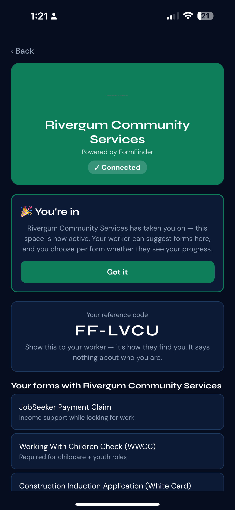
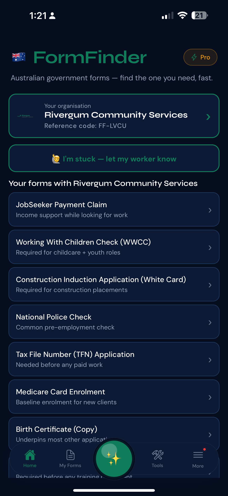

# 2026-09-26 — Org connect: space, reference code, suggested forms

Two screens from the FormFinder iOS app, captured after a client account was
connected to an organisation ("Rivergum Community Services"). Records what the
org-linked experience looks like end to end: the org space itself, and how the
link surfaces back on the home screen.

---

## 1. Org space — connected state

Top to bottom:

- **Back** nav at top left.
- **Org header card** (green fill): "Rivergum Community Services" /
  "Powered by FormFinder" / a **"✓ Connected"** status pill. A faint org
  watermark sits behind the title.
- **Onboarding callout**, green-outlined:
  > 🎉 **You're in**
  > Rivergum Community Services has taken you on — this space is now active.
  > Your worker can suggest forms here, and you choose per form whether they
  > see your progress.

  With a full-width **Got it** button (dismisses).
- **Reference code card**:
  > Your reference code
  > **FF-LVCU**
  > Show this to your worker — it's how they find you. It says nothing about
  > who you are.
- **"Your forms with Rivergum Community Services"** section heading, then the
  suggested-forms list beginning:
  - JobSeeker Payment Claim — *Income support while looking for work*
  - Working With Children Check (WWCC) — *Required for childcare + youth roles*
  - Construction Induction Application (White Card)

---

## 2. Home screen — org card in place

- **Header**: 🇦🇺 **FormFinder**, with a **⚡ Pro** badge top right.
  Tagline: "Australian government forms — find the one you need, fast."
- **Org card** (green-outlined, tappable, chevron right):
  > Your organisation
  > **Rivergum Community Services**
  > Reference code: FF-LVCU

  Org logo shown at left.
- **"🙋 I'm stuck — let my worker know"** — full-width outlined button directly
  under the org card.
- **"Your forms with Rivergum Community Services"** — the same suggested list,
  here shown in full:
  1. JobSeeker Payment Claim — *Income support while looking for work*
  2. Working With Children Check (WWCC) — *Required for childcare + youth roles*
  3. Construction Induction Application (White Card) — *Required for
     construction placements*
  4. National Police Check — *Common pre-employment check*
  5. Tax File Number (TFN) Application — *Needed before any paid work*
  6. Medicare Card Enrolment — *Baseline enrolment for new clients*
  7. Birth Certificate (Copy) — *Underpins most other applications*
  8. (partially visible, cut off by the tab bar) — *Required before any training
     placement*
- **Bottom tab bar**: Home (active), My Forms, a centre ✨ action button,
  Tools, More (carrying a red notification dot).

---

## What this shows working

- **Org connection completes and persists.** The org space reads "✓ Connected"
  and the home screen carries a matching org card with the same reference code
  (FF-LVCU) — the link survives navigation between the two screens.
- **Reference code is the identifier.** The copy makes the privacy stance
  explicit on screen: the code is what a worker uses to find the client, and it
  "says nothing about who you are."
- **Per-form progress sharing is stated up front.** The onboarding card tells
  the client the worker can suggest forms, and that visibility of progress is
  the client's choice *per form* — set as an expectation before any form is
  opened.
- **Suggested-forms list renders in both places** with title + one-line
  plain-English purpose per form, consistent between the org space and home.
- **Escalation path exists on home.** "I'm stuck — let my worker know" sits
  directly beneath the org card, one tap from the main screen.

---

## Open questions / next

- The 8th form in the home list is cut off by the tab bar — worth checking the
  list has bottom padding clear of the tab bar so the last item isn't obscured.
- The org space shows only the first 3 forms above the fold; unclear whether it
  scrolls to the full 8 or is deliberately truncated.
- Per-form progress sharing is *promised* in the onboarding copy but no
  per-form toggle is visible in either screenshot — not yet evidenced.
- "Got it" dismissal behaviour (one-time vs. returns) isn't shown.
- The **More** tab has an unread dot with no visible source on these screens.
